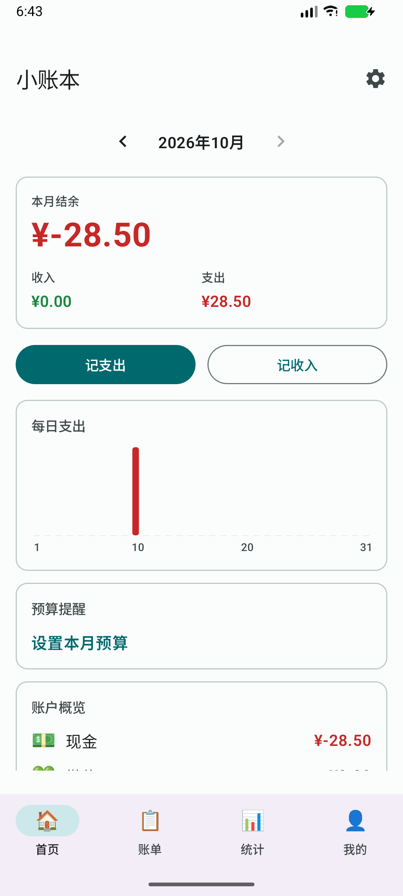
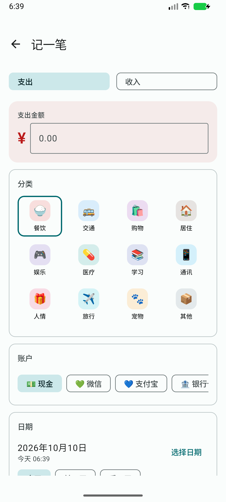
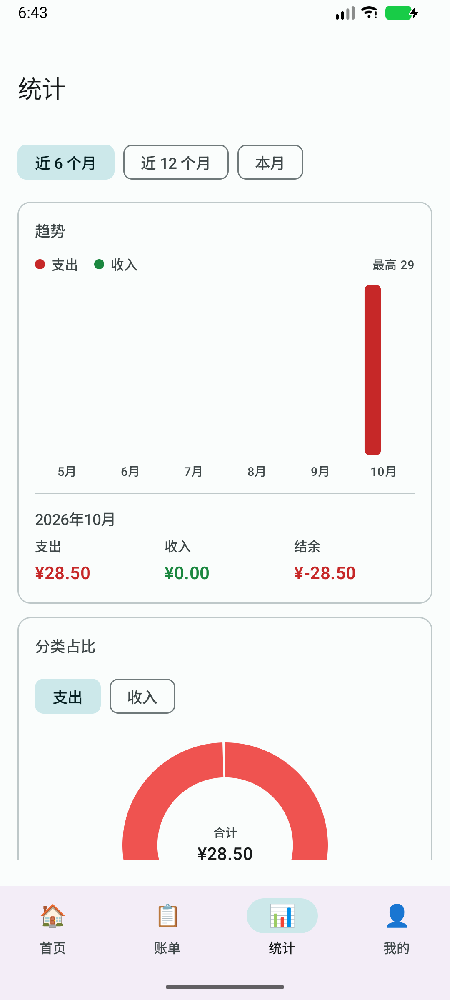
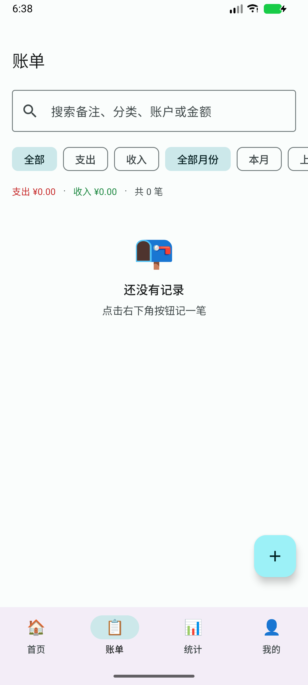
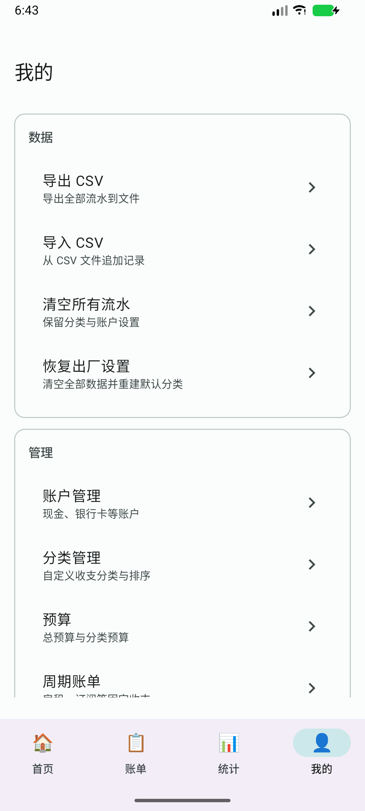
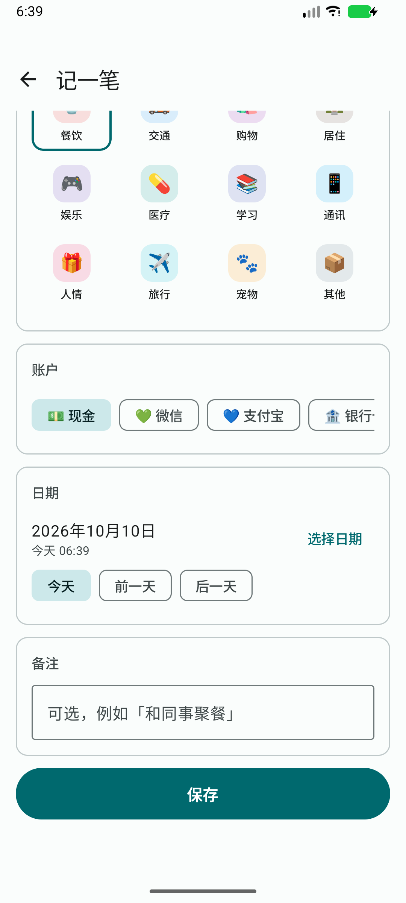

# 小账本（XiaoZhangBen）

一个纯本地的安卓个人记账 App。Kotlin + Jetpack Compose + Material 3，数据只存在手机本地，不联网、不上传。

**当前状态：已编译出 APK，并在 Android 模拟器（API 37）上实测通过** —— 装包、启动、记一笔 28.50、首页/账单/统计/设置各页渲染、数据跨重装保留，全部正常，无崩溃。

| debug 包（11.93 MB） | release 包（8.32 MB） |
| --- | --- |
| `app/build/outputs/apk/debug/app-debug.apk` | `app/build/outputs/apk/release/app-release.apk` |
| 包名 `com.xiaozhangben.ledger.debug`（可与正式版共存） | 包名 `com.xiaozhangben.ledger` |

## 界面截图

| 首页 | 记一笔 | 统计 |
| --- | --- | --- |
|  |  |  |

| 账单 | 我的 | 记一笔（下半部分） |
| --- | --- | --- |
|  |  |  |

## 功能

| 模块 | 说明 |
| --- | --- |
| 记一笔 | 收入 / 支出，金额、分类、账户、备注、日期（支持补记任意日期） |
| 首页 | 本月结余、收入、支出，每日支出柱状图，预算提醒，账户概览，最近 8 条记录 |
| 账单列表 | 关键词搜索 + 类型 / 月份 / 分类 / 账户筛选，按天分组并显示当日合计，点击可编辑或删除 |
| 统计 | 近 6 月 / 近 12 月 / 本月收支趋势双柱图，分类占比环形图 + 排行占比条，每日支出柱状图 |
| 账户 | 现金 / 微信 / 支付宝 / 银行卡 / 信用卡 / 其他，初始余额、账户配色、净资产合计、归档 |
| 分类管理 | 支出与收入分开，可增删改、自定义 emoji 图标与颜色、上下排序，被引用的分类只能归档 |
| 预算 | 本月总预算 + 分类预算，进度条，超 80% 黄色提醒、超支红色提醒并汇总到页面顶部 |
| 周期账单 | 每天 / 每周 / 每月 / 每年，可开关、可设「到期自动补记」，也可手动「立即记一笔」 |
| CSV 备份 | 导出全部流水到任意位置（系统文件选择器），导入时按名称自动补建缺失的分类和账户 |
| 应用锁 | 4 位数字密码（PBKDF2 加盐哈希，仅存本机）+ 指纹 / 面容解锁，退到后台自动重新上锁 |
| 外观 | 跟随系统 / 浅色 / 深色 |

## 环境要求

> ⚠️ 本机目前只有 **JDK 8**，现代 Android 构建需要 **JDK 17 或更高**；也没有任何 Android SDK。开工前必须补齐下面两项。

- **JDK 17**（Temurin / Oracle / 微软 OpenJDK 均可）
- **Android SDK**：`platforms;android-35`、`build-tools;35.0.0`、`platform-tools`
- Gradle 由工程自带的 wrapper 提供（8.11.1），首次构建自动下载，无需单独安装

### 方式三：本机一键脚本（本机已实测通过 ✅）

这台机器的环境和常规情况差别很大，实测能编译出 APK 的组合如下：

| 项 | 本机实际情况 | 处理方式 |
| --- | --- | --- |
| Android Studio | 装在 `D:\安卓studio`（2026.2.1） | 只用它的 SDK，不用它构建 |
| Android SDK | `D:\Androidstudio`，原本只有 platform 37.0 + build-tools 36.0.0 | 脚本补装 platform 35 + build-tools 35.0.0 |
| Studio 自带 JDK | **JBR 25**，Gradle 8.11.1 跑不了 | 脚本另下 OpenJDK 17 到 `..\tools\jdk-17` |
| `services.gradle.org` | 实测只有 0.11 MB/s（要 20 分钟） | 改用华为云镜像，**9.15 MB/s** |
| `repo1.maven.org` | TLS 证书信任失败 | `settings.gradle.kts` 已把阿里云镜像放在最前 |
| `sdkmanager` | 下不动仓库清单（Java 网络问题） | 改为用 curl 直接抓 Google 官方包解压 |
| 受限会话 | 用户目录下的 `.gradle` / `.tmp` 不可写 | 缓存与临时目录都改到工作区内 |
| AGP 默认 build-tools | 8.7.3 默认要 **34.0.0** | `app/build.gradle.kts` 里显式写 `buildToolsVersion = "35.0.0"` |

两个脚本（**用 PowerShell 5.1 跑，注意加 `-ExecutionPolicy Bypass`**）：

```powershell
cd xiaozhangben

# 一次性环境准备：下载 JDK 17、命令行工具，补装 SDK 组件，写 local.properties
powershell -NoProfile -ExecutionPolicy Bypass -File setup-env.ps1

# 只检查环境，不编译
powershell -NoProfile -ExecutionPolicy Bypass -File build-apk.ps1 -Check

# 编译 debug / release
powershell -NoProfile -ExecutionPolicy Bypass -File build-apk.ps1
powershell -NoProfile -ExecutionPolicy Bypass -File build-apk.ps1 -Variant Release
```

`build-apk.ps1` 会自动做这些事：找 SDK、找 JDK 17、生成 `local.properties`、
把 `GRADLE_USER_HOME` / `ANDROID_USER_HOME` / `TEMP` 指向工作区内的 `..\tools\`，
然后调用工程自带的 `gradlew.bat`，最后打印 APK 路径。

> 脚本里这些环境变量是给「受限沙箱会话」准备的。如果你在普通命令行里手工构建，
> 不设它们也没问题（Gradle 会用默认的 `~/.gradle`）。

### 方式一：用 Android Studio 开发（推荐）

下面表里的路径都是我这台机器的，换机器请按自己的环境替换。图中提到的 `tools/` 是本地构建环境（JDK 17 与 Gradle 缓存），**不在仓库里**。

| 需要解决的事 | 工程里已经写好的地方 |
| --- | --- |
| Studio 自带 JBR 是 **JDK 25**，Gradle 8.11.1 跑不了 | 在本机 `~/.gradle/gradle.properties` 写一行 `org.gradle.java.home=<你的 JDK 17 路径>`；或在 Studio 里把 **Gradle JDK** 指到 JDK 17 |
| Studio 默认会从 `services.gradle.org` 重下 Gradle（那源只有 0.11 MB/s） | `.idea/gradle.xml` 里的 `serviceDirectoryPath` 指向已下好的 `tools/gradle-home` |
| SDK 在非默认位置 `D:\Androidstudio` | `local.properties` 里的 `sdk.dir` |

操作步骤：

1. 打开 **Android Studio**（`D:\安卓studio`）→ `File → Open` → 选择本目录（`xiaozhangben`）。
2. 等 Gradle Sync 完成。**首次会建索引，需要几分钟**；依赖已经缓存好了，不用重新下载。
3. 手机开启「开发者选项 → USB 调试」插上，或建个模拟器，点右上角 **Run ▶** 直接装到设备上。
4. 只想要 APK：`Build → Build Bundle(s) / APK(s) → Build APK(s)`，
   产物 `app/build/outputs/apk/debug/app-debug.apk`。

**两条注意事项：**

- 如果弹出「Android Gradle Plugin 版本过旧，建议升级」——**选不要升级**。
  升级会连带把 Gradle、Kotlin、KSP、Room 全换一代，构建配置要大改。
- 如果 Sync 报错说 Gradle JDK 无效，说明 `tools/jdk-17` 被删了或挪了位置。
  在 `~/.gradle/gradle.properties` 里加一行 `org.gradle.java.home=<你自己的 JDK 17 路径>`，
  要么在 `Settings → Build, Execution, Deployment → Build Tools → Gradle`
  里把 **Gradle JDK** 指到同一个 JDK 17。

> `.idea/` 目录在 `.gitignore` 里（IDE 配置通常不入库）。你要是把工程打包带走，
> 记得把 `.idea/gradle.xml` 一起带上，或者在 Studio 里手工设一次 Gradle user home。

### 方式二：纯命令行（不装 Android Studio）

```powershell
# 1) 装 JDK 17，设置 JAVA_HOME（示例，路径按实际改）
$env:JAVA_HOME = 'C:\Program Files\Eclipse Adoptium\jdk-17'

# 2) 装 Android 命令行工具后，安装 SDK 组件并接受许可
sdkmanager "platform-tools" "platforms;android-35" "build-tools;35.0.0"
sdkmanager --licenses

# 3) 在本目录创建 local.properties，指向 SDK（反斜杠要转义）
#    sdk.dir=D\:\\Android\\Sdk

# 4) 构建
.\gradlew.bat assembleDebug
# 产物：app\build\outputs\apk\debug\app-debug.apk
```

## 网络说明（本机实测结果）

这台机器在国内网络环境下：

- `repo1.maven.org`（Maven Central）直连会 **TLS 证书信任失败**；
- 阿里云镜像、`dl.google.com`、`services.gradle.org` 可达。

因此 `settings.gradle.kts` 已把 **阿里云镜像放在官方源之前**：

```kotlin
maven { url = uri("https://maven.aliyun.com/repository/google") }
maven { url = uri("https://maven.aliyun.com/repository/public") }
```

如果 Gradle 发行版（约 130 MB）下载太慢，把 `gradle/wrapper/gradle-wrapper.properties` 里的
`distributionUrl` 换成腾讯云镜像即可：

```properties
distributionUrl=https\://mirrors.cloud.tencent.com/gradle/gradle-8.11.1-bin.zip
```

## 想改代码？常见改动位置

| 想改什么 | 改哪个文件 |
| --- | --- |
| App 名字 | `app/src/main/res/values/strings.xml` 的 `app_name` |
| 主题配色 | `ui/theme/Color.kt` 里的 `LightColors` / `DarkColors`（如 `primary`） |
| 默认分类、默认账户、图标候选 | `data/db/DefaultData.kt`（只在首次启动写入，改完要卸载重装才看得到） |
| 货币符号 | `domain/Money.kt` 里的 `CURRENCY`（默认 `¥`） |
| 金额解析 / 日期规则 | `domain/Money.kt`、`domain/DateUtils.kt` |
| 统计口径 | `domain/StatsCalculator.kt`（纯函数，好改） |
| 数据读写逻辑 | `data/repo/LedgerRepository.kt`（全应用唯一数据入口） |
| 某个页面的界面 | `ui/<功能>/XxxScreen.kt` 与同目录的 `XxxViewModel.kt` |
| 加新页面 | 新建 `ui/xxx/` 两个文件 → 在 `ui/AppViewModelProvider.kt` 注册 ViewModel → 在 `ui/navigation/AppNavigation.kt` 加路由 |
| 锁屏逻辑 | `ui/lock/`（PIN 哈希在 `data/prefs/PinHasher.kt`） |

`docs/UI_CONTRACT.md` 是界面层的接口约定（共享组件签名、仓库 API、ViewModel 规范），
扩展新页面时照着写能少踩坑。

> ⚠️ **改数据库表结构会清空数据**：`AppDatabase` 目前 `version = 1`，且启用了
> `fallbackToDestructiveMigration()`。加字段时要把 version 改成 2，否则升级后会闪退；
> 改完老数据会被清掉，动表结构前先用 App 里的「导出 CSV」备份。

## 目录结构

```
xiaozhangben/
├─ app/src/main/java/com/xiaozhangben/ledger/
│  ├─ LedgerApp.kt                  Application，持有依赖容器
│  ├─ MainActivity.kt               入口（FragmentActivity，指纹解锁需要）
│  ├─ core/AppContainer.kt          手写依赖容器
│  ├─ domain/                       领域层：模型、金额、日期、统计、周期引擎
│  ├─ data/
│  │  ├─ db/                        Room：实体、DAO、数据库、默认分类账户
│  │  ├─ prefs/                     DataStore：锁、主题、备份时间；PIN 哈希
│  │  ├─ backup/                    CSV 编解码 + 系统文件选择器读写
│  │  └─ repo/LedgerRepository.kt   全应用唯一数据入口
│  └─ ui/
│     ├─ theme/  components/        配色主题、共享组件、自绘图表
│     ├─ navigation/                路由与底部导航
│     ├─ home/ records/ editor/     首页、账单、记一笔
│     ├─ stats/ budget/ accounts/   统计、预算、账户
│     ├─ categories/ recurring/     分类管理、周期账单
│     ├─ settings/                  设置（含 CSV 导入导出）
│     └─ lock/                      密码 / 指纹锁屏与设置
├─ docs/UI_CONTRACT.md              界面层共享契约（开发用）
└─ gradle/libs.versions.toml        依赖版本目录
```

## 技术选型

| 项 | 版本 |
| --- | --- |
| Kotlin | 2.0.21（含 Compose 编译器插件） |
| Android Gradle Plugin | 8.7.3（Gradle 8.11.1） |
| compileSdk / targetSdk / minSdk | 35 / 35 / 26（Android 8.0 起） |
| Compose BOM | 2024.12.01（Material 3） |
| Room | 2.6.1（KSP） |
| DataStore Preferences | 1.1.1 |
| androidx.biometric | 1.1.0 |

图表是**自己用 Canvas 画的**（柱状图、环形图、占比条），没有引入任何第三方图表库。
分类图标用 **emoji**，因此也没有引入体积很大的 `material-icons-extended`。

## 数据与隐私

- 所有数据保存在本机 `ledger.db`（Room / SQLite），应用**不申请网络权限**，除指纹外无任何权限。
- 应用锁只保存 PIN 的 **PBKDF2-HMAC-SHA256 加盐哈希**（12 万次迭代），不保存明文；忘记密码无法找回。
- CSV 导出格式（UTF-8，带 BOM 容错）：

```csv
日期,类型,金额,分类,账户,备注
2026-01-31 08:30,支出,28.50,餐饮,微信,早餐
```

导入时会按名称匹配分类与账户，没有的自动创建；金额为负数的记录按支出处理。

## 设计取舍与已知限制

- **统计在内存里聚合**：个人记账数据量很小，换来的是没有 SQL 方言坑、逻辑集中可读。
- **周期账单在启动时补记**：打开 App 时把到期的规则一次性补上并推进下次时间，没有引入 WorkManager / 前台服务，所以不是「到点就推送」。
- **release 包用 debug 签名**：方便直接安装体验；如果要上架应用商店，请替换 `app/build.gradle.kts` 里的 `signingConfig`。
- 被流水引用的分类 / 账户不允许硬删除，只能归档（否则历史记录会变成「未分类」）。
- 数据库版本目前是 1，且启用了 `fallbackToDestructiveMigration()`：以后改表结构会清空数据，升级前请先导出 CSV。
